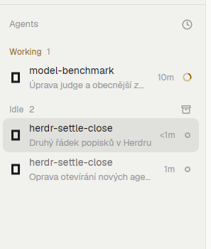

<h1 align="center">Herdr · Settle Closes</h1>

<p align="center">
  A <a href="https://herdr.dev">Herdr</a> package for agent-first work: start an agent in any project,<br/>
  in a worktree when you want one, and let <b>Settle</b> clean up after it.
</p>

<p align="center">
  
  
  
  
</p>

<p align="center">
  
</p>

## The problem

Herdr's **settle** is gentle: it puts a tab away but keeps it running, and in a
tab bar that lists every tab the finished work stays around. After a day of
agents you have a row of zombie tabs and terminals you no longer need.

This mod makes settle mean what it says: **the work is done, clean it up**.

## What you get

- **Settle = close.** The archive button on an agent row closes its tab
  (`tab.close`), which ends the terminal and the agent in it.
- **Agents and Terminals, no Spaces.** The `main-settle` layout lists Agents
  and, under them, your plain terminals. Spaces still exist, but they are
  plumbing: New agent makes one when a project needs it, and settling the last
  tab of a space closes it. The project stays in New agent's list.
- **Terminals.** A tab without an agent shows in the Terminals list with a
  shell icon, its name and its folder. The `+` there opens New agent with the
  Terminal chip selected; the archive button on hover closes the tab the same
  way Settle does.
- **Safe by default.** The button only appears for `idle` and `done` agents.
  A working or blocked agent shows only *pin*, so a stray click cannot kill a
  running turn.
- **Settle all.** The group header's archive button cleans up every finished
  agent in that group the same way.
- **New agent.** `ctrl-shift-a` or the `+` in the Agents header opens one dialog:
  project, agent, task and a **New worktree** switch. See below.
- **Worktrees clean up after themselves.** See [Settling a worktree](#settling-a-worktree).
- **The rest is the stock panel.** Priority / grouped-by-space sorting, pins,
  sub-agent trees, attention states, the compact rail — all unchanged.

> The archive icon in the screenshot is *Settle all* for the Idle group. On a
> row, pin and settle appear on hover, next to the agent's name.

<p align="center">
  
</p>

## New agent

The `main-settle` layout has no Spaces panel: the **New agent** dialog picks a
project, and Herdr's space for it is made and closed for you. A project does
not need a space first.

- **Project:** the open local spaces first (the active one on top), named
  after the space and keyed by its live folder, then the projects you have
  started an agent in before that have no open space, most recent first. A
  folder is listed once. Nothing is scanned or asked of git while the dialog
  opens, so it paints at once. Remote spaces are not listed. A project without
  a space gets a new space when you start.
- **History:** Start remembers the project (30 at most) in `new-agent.recent`
  in `~/.config/herdr-app/shared.json`: the repo's main checkout when the folder
  is in git, else the folder itself. Remove the key to forget them.
- **Filter:** the *Filter projects* input above the list narrows it as you
  type, by name or folder path (also as `~/...`), ignoring case and accents.
  The selection moves to the first match; with no match Start is dimmed.
  Typing in the task box stays the fast path: `ctrl-shift-a`, type, Enter.
  `tab` goes filter, task, branch (when the worktree is on) and round.
- **Other folder…:** the last row, or `alt-o`, opens the system folder picker.
  The folder joins the list, is selected and is remembered when you start. No
  folder is scanned for, and there is no root to configure.
- **Agent:** installed agents as chips. The list is stored the first time, so
  the dialog does not ask again; to pick up a newly installed agent, remove
  `new-agent.agents` from `~/.config/herdr-app/shared.json`.
  *Set as default* above the list remembers one; otherwise the last agent used
  is selected. Picking another chip for one launch does not change the default.
  A **Terminal** chip always comes last, even with no agents installed: Start
  opens a plain shell in the project (or its new worktree), named by Herdr. It
  can be the default too, but it can't take a task, so Start asks you to clear
  it or pick an agent.
- **New worktree off:** a new tab in the space's live folder (a new space when
  the project has none or the space has gone).
- **New worktree on:** a branch, a checkout in
  `~/.herdr/worktrees/<repo>/<branch>`, and a space nested under the repo. The
  branch name comes from the task (`agent/fix-login`), follows the task until
  edited, and can be typed. The switch is only available for a project in git.
- **The switch starts off.** A space with an agent working or blocked is
  noted, but only a click or `alt-w` turns the switch on. Git runs only when
  it is on.

A task reaches OpenCode through `--prompt` and Copilot/Antigravity through
`-i`; the rest take Herdr's positional argument. Kimi cannot take a task at
startup, so Start asks you to clear it or pick another agent.

Enter or the **Start** button starts the agent, `tab` moves between fields,
`alt-w` toggles the worktree and `alt-a` picks the next agent. Start is dimmed
until a space and an agent are chosen. The dialog works on this computer
only; spaces on other machines are not listed yet. A worktree starts empty of
ignored files, so a project that needs `.env` or `node_modules` has to set
those up.

## Settling a worktree

Settling the last tab of a space in `~/.herdr/worktrees`:

- **No uncommitted changes, and merged into the branch the main checkout is on:**
  the space closes and the worktree is removed. The branch stays.
- **Anything else:** Herdr's *Remove worktree* dialog asks first, and cancelling
  leaves everything as it was. `Settle all` skips these instead of asking.

Any other tab or space settles as described above: the tab closes, and on a
space's last tab Herdr closes the space with it, without a fresh tab first. A
worktree you created elsewhere is never removed.

## Install

### From a release (recommended)

1. Download `herdr-settle-close-0.1.0.zip` from
   [Releases](https://github.com/rdurica/herdr-settle-close/releases/latest).
2. Unzip and run the installer:

```sh
unzip herdr-settle-close-0.1.0.zip
cd herdr-settle-close
./install.sh
```

The installer copies `mods/agents-clean/`, `mods/new-agent/` and
`layouts/main-settle.json` into `~/.config/herdr-app/`, adds `ctrl-shift-a` to
`keys.json`, runs `herdr-app check`, and switches the window to the
`main-settle` layout. An existing layout with that name is never overwritten,
and a key you already use is left alone. Run it again to update; locally
changed mod files and `keys.json` are backed up to
`~/.cache/herdr-settle-close/` first.

Use Herdr from another folder? `HERDR_APP_HOME=/path ./install.sh`.

### Manually

```sh
cp -R mods/agents-clean mods/new-agent ~/.config/herdr-app/mods/
cp layouts/main-settle.json ~/.config/herdr-app/layouts/
herdr-app check ~/.config/herdr-app/mods/agents-clean
herdr-app check ~/.config/herdr-app/mods/new-agent
```

Add `"ctrl-shift-a": "mod.open:new-agent"` to the `global` section of
`~/.config/herdr-app/keys.json`.

Then pick the layout with `ctrl-shift-l`, or:

```sh
herdr-app do layout.switch --name main-settle
```

You can also clone your own layout (`herdr-app do layout.clone --name main --as my-layout`)
and point its agents block at `"mod": "agents-clean"`.

### Requirements

- Herdr desktop **0.9.x** (the version with mods / `gpui-kit`).
- `bash` for the installer; the manual copy works everywhere.
- No extra programs, no network access, no build step.

## How it works

`agents-clean` is a copy of the shipped **Agents** panel with settling rewritten
and a `+` in its header. With `props: { terminals: true }` the same mod draws
the Terminals list instead (`terminals.js` picks the rows). `new-agent` is a
separate dialog mod. This is the basic settle, in `mods/agents-clean/close.js`;
`settle.js` holds the worktree decisions:

```js
// Settling ends the work: close its tab (and the terminal in it). A tab that is
// its space's last one closes the space with it.
function settleTab(spaceId, tabId) {
  run("tab.close", { id: tabId });
}
```

The hover action calls it instead of `tab.settle`:

```js
const finished = a.status === "idle" || a.status === "done";
const settle = !finished ? null : action(
  `settle-${a.address}`, "archive", "Settle: close its tab and end it",
  () => settleTab(a.space, a.tab),
);
```

`layouts/main-settle.json` is a copy of the stock `main` layout without the
Spaces list: its `agents` block points at `agents-clean` and a `terminals` block
below it at `agents-clean` with the `terminals` prop. Everything else (tabs,
files panel, status bar) is the shipped setup.

## Safety

- **Destructive by design.** Settle ends the terminal. There is no undo, and a
  running agent's turn is lost — that is why the button is gated on `idle` /
  `done`.
- `Settle all` is always visible on groups that have finished agents and closes
  several tabs one after another, waiting for each close to land.
- The built-in `tab.settle` command (palette, CLI, keys) is part of the Herdr
  core and still only parks a tab. This mod changes the panel's button only.
- A finished agent is not settled while another agent in its tab is working or
  blocked.
- **The mods run local programs.** `new-agent` runs `git` only when the New
  worktree switch is on, and `agents-clean` runs `git` when it settles a
  space's last tab. Neither reaches the network. `git worktree remove` never
  runs with `--force` from Settle, so doubt keeps the worktree.

## Customize

- **Name / folder:** if you rename `mods/agents-clean`, update `mod.json`,
  the layout's `"mod": "agents-clean"`, and the sort popup's
  `openOverlay({ mod: "agents-clean" })` inside `main.js`.
- **Allow settling working agents:** change the `finished` check in
  `mods/agents-clean/main.js` — know that it kills the turn.
- **Different look:** layouts take theme colors, fonts and sizes; the layout's
  sidebar width, tab bar height and panel are plain numbers in
  `layouts/main-settle.json`.
- **Upstream updates:** this is a copy of the `agents` mod shipped with Herdr
  0.9.x (version 0.1.10). After a Herdr update, copy the new `mods/agents`
  over and re-apply `settleTab` + the button change, or the panel will fall
  behind new features.

## Uninstall

```sh
rm -rf ~/.config/herdr-app/mods/agents-clean ~/.config/herdr-app/mods/new-agent
rm ~/.config/herdr-app/layouts/main-settle.json
```

Remove the `ctrl-shift-a` line from `keys.json`. Switch to another layout first (`ctrl-shift-l`); Herdr keeps running as before.

## Repository layout

| Path | What it is |
|---|---|
| `mods/agents-clean/` | the Agents panel: `main.js`, `settle.js`, `mod.json` |
| `mods/new-agent/` | the New agent dialog: `main.js`, `logic.js`, `mod.json` |
| `layouts/main-settle.json` | the layout that shows the panel |
| `install.sh` | copies all of it into the app home and checks it |
| `tests/` | `node --test`, not part of a release |
| `RECIPE.md` | a build brief, in the format [herdr.dev/mods](https://herdr.dev/mods) uses |
| `preview.png` | screenshot for the share page |
| `package.sh` | builds `dist/herdr-settle-close-<version>.zip` |
| `VERSION` | release version |
| `CHANGELOG.md` | what changed |

## Development

```sh
herdr-app check mods/agents-clean     # must pass
./package.sh                          # build the release zip
```

Edits apply live while Herdr runs; `herdr-app status` lists any file or mod
errors, and `herdr-app shot` saves the current frame for a quick look.

## Sharing

The repo follows the Herdr share format (`mods/`, `RECIPE.md`, `preview.png`),
so it can be published at [herdr.dev/mods](https://herdr.dev/mods) — the
GitHub topic is `herdr-mod`.

## License

[MIT](LICENSE) © Robert Durica
