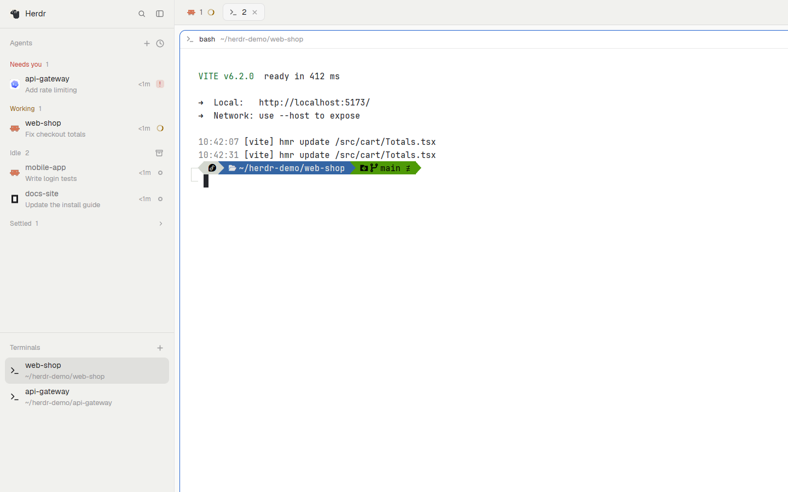
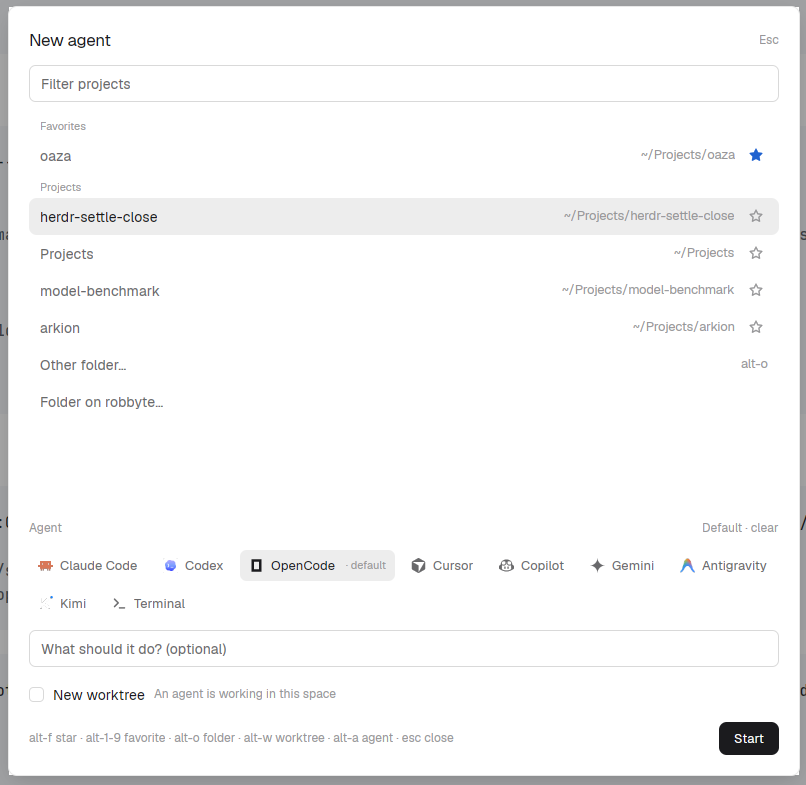

<h1 align="center">Herdr · Agents first</h1>

<p align="center">
  <strong>Don't work with projects. Work with tasks.</strong><br/>
  A Herdr sidebar that lists the work instead of the spaces:<br/>
  agents that need you on top, your terminals below, one key to start the next job.
</p>

<p align="center">
  
  
  
  
</p>

<p align="center">
  
</p>

## Why

Herdr's stock window is built around **spaces**: one per repo, each with its
tabs. When most of your work is agents, that list is bookkeeping. You want
three things: who needs you, what is still working, and where your shells are.

Agents first drops the space list. Spaces still exist — New agent makes them,
Settle closes them — you just never manage them.

## What you get

| | |
|---|---|
| **Agents** | *Needs you*, *Working*, *Done*, *Idle* — pins, sub-agents, click to jump. |
| **Terminals** | Every tab without an agent, with its project and folder. |
| **New task** (`ctrl-shift-a`) | Type the task, press Enter. Project and agent are pre-picked; worktree optional. |
| **Settle closes** | Archiving a finished agent closes its tab; a merged worktree goes with it. |

## A quick tour

1. **`ctrl-shift-a`** (or `+` in the Agents header). Type what the agent should
   do, press Enter. The project defaults to the one you are in.
2. **Watch the list.** Rows move between *Needs you*, *Working* and *Done*;
   click one to jump to it.
3. **Need a shell?** `+` in the Terminals header opens the same dialog with
   *Terminal* selected.
4. **Done?** Hover the agent and click archive, or *Settle all* on the group.

<p align="center">
  
</p>

## Start a task

`ctrl-shift-a` opens one dialog: a project, an agent, a task and an optional
git worktree. Nothing is scanned while it opens, so it paints at once.

- **Project** — favourites first, then the open spaces from every connected
  machine, then the projects you started an agent in before (50 at most). The
  active space's row is still selected by default. *Filter projects* narrows by
  name, folder or machine; *Other folder…* (`alt-o`) picks any folder, and each
  remote machine gets a folder browser.
- **Favorites** — the star on a project row pins its folder to the top of the
  list. Click it again to remove it; adding a git worktree stores its main
  checkout instead, so settling the worktree away does not lose the favourite.
- **History** — Start remembers the project (50 at most) in `new-agent.recent`,
  and every open workspace's folder is remembered as it opens, so closing a
  space keeps it in the list.
- **Agent** — the installed agents on the project's machine, as chips. *Set as
  default* remembers one; otherwise the last one used is selected. A
  **Terminal** chip always comes last and starts a plain shell.
- **Task** — goes to the agent through its own flag (OpenCode `--prompt`,
  Copilot/Antigravity `-i`, the rest Herdr's positional argument). Kimi can't
  take one at startup, so Start asks you to clear it or pick another agent.
- **New worktree** — off by default. On, Start makes a branch named after the
  task (`agent/fix-login`) and a checkout in
  `~/.herdr/worktrees/<repo>/<branch>` on the project's machine.

`tab` moves between fields, `alt-w` toggles the worktree, `alt-a` picks the
next agent, `alt-f` stars the selected project and `alt-1`…`alt-9` select a
favourite, Enter starts. Start stays dimmed until a project and an agent are
chosen. Remote machines come from Herdr's *Settings → Machines* (or
`hc machine add`) and must be connected first.

## Terminals

The list under Agents shows every tab without an agent, with its project and
folder (and the machine for a remote one). Click to focus it, hover to close
it. `+` opens New agent with Terminal selected; your default agent does not
change. There is no idle/done gate here — a shell has no status, so you decide.

## Settle

Herdr's built-in settle parks a tab and keeps it running. Here, the archive
button on an `idle` or `done` agent **closes** the tab and ends the agent.
Working and blocked agents show only *pin*, so a stray click cannot kill a
running turn. *Settle all* does the same for every finished agent in a group,
one tab after another.

Closing a space's last tab closes the space; the project stays in New agent's
list. For the last tab of a space in `~/.herdr/worktrees`:

- **clean and merged** into the main checkout's branch — the worktree is
  removed and the branch stays;
- **anything else** — Herdr's *Remove worktree* dialog asks first, and
  *Settle all* skips it with a warning.

A worktree you created elsewhere is never removed.

## Install

### From a release (recommended)

1. Download `herdr-agents-first-<version>.zip` from
   [Releases](https://github.com/rdurica/herdr-agents-first/releases/latest).
2. Unzip it and run the installer:

```sh
unzip herdr-agents-first-*.zip
cd herdr-agents-first
./install.sh
```

It copies both mods and the `agents-first` layout into `~/.config/herdr-app/`,
adds `ctrl-shift-a` to `keys.json` (a key you already use is left alone), runs
`herdr-app check` and switches the layout. An existing layout is never
overwritten; locally changed files are backed up to
`~/.cache/herdr-agents-first/` first. Run it again to update. Different Herdr
home? `HERDR_APP_HOME=/path ./install.sh`.

### Manually

```sh
cp -R mods/agents-clean mods/new-agent ~/.config/herdr-app/mods/
cp install/agents-first.json ~/.config/herdr-app/layouts/
herdr-app check ~/.config/herdr-app/mods/agents-clean
herdr-app check ~/.config/herdr-app/mods/new-agent
herdr-app do layout.switch --name agents-first
```

Add `"ctrl-shift-a": "mod.open:new-agent"` to the `global` section of
`~/.config/herdr-app/keys.json`.

Prefer your own layout? Point its agents block at `{"mod": "agents-clean"}` and
add a block `{"mod": "agents-clean", "props": {"terminals": true}}` where you
want the Terminals list.

### Upgrading from Settle closes

This package used to be called *Settle closes*, with a `main-settle` layout.
The mods keep their names, so `./install.sh` updates them in place and adds the
`agents-first` layout. Remove `~/.config/herdr-app/layouts/main-settle.json`
once you have switched; the installer reminds you while it is there.

### Requirements

- Herdr desktop **0.9.x** (the version with mods / `gpui-kit`).
- Remote projects need the machine added and connected in Herdr
  (`hc machine ls` shows it).
- `bash` for the installer; the manual copy works everywhere.
- No extra programs, no network access, no build step.

## Safety

- **Settle is destructive by design.** It ends the terminal; there is no undo.
  The built-in `tab.settle` command (palette, CLI, keys) still only parks a tab.
- **The mods run programs on this computer or the project's machine.**
  `new-agent` runs `git` only with the New worktree switch on and checks
  installed agents through Herdr; `agents-clean` runs `git` when it closes a
  space's last tab. Neither reaches the network, and `git worktree remove`
  never runs with `--force`.

## How it works

- `agents-clean` is the shipped **Agents** panel (Herdr 0.9.x) with Settle
  rewritten and a `+` in its header. With `props: {terminals: true}` the same
  mod draws the Terminals list, so both share one close path.
- `new-agent` is the dialog. `logic.js` holds everything testable without
  Herdr: the machine-aware project list, history, filter, branch names and
  launch plans.
- `install/agents-first.json` is the stock `main` layout with Spaces replaced
  by Agents (two thirds) and Terminals (one third).

After a Herdr update that changes `mods/agents`, copy it over `agents-clean`
again and re-apply the settle and Terminals changes, or the panel falls behind.

## Uninstall

```sh
rm -rf ~/.config/herdr-app/mods/agents-clean ~/.config/herdr-app/mods/new-agent
rm ~/.config/herdr-app/layouts/agents-first.json
```

Remove the `ctrl-shift-a` line from `keys.json`. Switch to another layout first
(`ctrl-shift-l`); Herdr keeps running as before.

## Details

Every rule behind the dialog, the panel and Settle — filter matching, the folder
browser, per-machine agent lists, task flags, worktree decisions — is in
[RECIPE.md](RECIPE.md). That file is also the brief herdr.dev shows on the
[mods page](https://herdr.dev/mods/), so this README stays short on purpose.

## Repository layout

| Path | What it is |
|---|---|
| `mods/agents-clean/` | the Agents and Terminals panel |
| `mods/new-agent/` | the New agent dialog |
| `install/agents-first.json` | the layout (kept out of `layouts/`, which herdr.dev skips) |
| `install.sh`, `package.sh` | install into the app home; build a release zip |
| `RECIPE.md`, `preview.png` | the herdr.dev brief and listing picture |
| `assets/`, `tests/` | README pictures; `node --test tests/*.test.mjs` |

## Development

```sh
node --test tests/*.test.mjs
herdr-app check mods/agents-clean && herdr-app check mods/new-agent
./package.sh
```

Edits apply live while Herdr runs; `herdr-app status` lists any file or mod
errors, and `herdr-app shot` saves the current frame.

## License

[MIT](LICENSE) © Robert Durica
