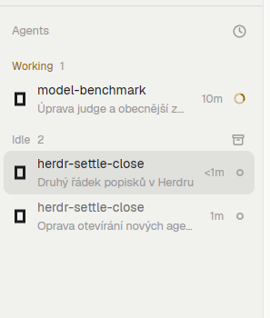

# Agents (settle closes)

The shipped Agents sidebar with one promise changed: **Settle** no longer parks
a tab, it closes it and ends the agent in it. If the tab is its space's last
one, a fresh tab is opened first so the space stays. A finished agent is one
hover click away from being cleaned up, and the tab bar stays empty of old work.

## What you see

A vertical sidebar panel, drawn with the theme's `chrome` background, a 1px top
border and 13px text. Top to bottom:

- a 41px header: "Agents" in 11.5px medium `dim` text on the left, and on the
  right the current sort icon (a clock for Priority, layers for Grouped by
  space) with a tooltip "Sort agents: <sort>".
- a scrolling list of agent rows, 30px tall (44px when the row names its space
  and a detail line sits under it), 8px inner padding on the sides, 9px gaps.
  Each row: the program's icon (16px, tinted SVG or image), a name (truncated),
  a second 11.5px dim line under it with the tab's name, or the agent's own
  session title when the tab only has its automatic name (priority view,
  pinned and Settled rows; no `·` prefix; OpenCode's `OC | ` is dropped), the
  machine name for remote agents, a fold chevron with the sub-agent count when
  the agent has live sub-agents,
  and at the right a status mark: a 900ms spinner for `working`, a "Needs you"
  pill (or a compact `!` in priority view) for `blocked`, a hollow ring for
  `idle`, a dot for `done`. The focused row uses `selected`; hover uses `hover`;
  idle names are `muted`, others `foreground`.
- group headers, 30px: "Pinned", then either "Needs you" / "Done" / "Working" /
  "Idle" (priority sort) or one per space (grouped sort), and "Settled" last.
  A header shows its count (always in priority view, for Settled, and when
  folded), a fold chevron when folded, and — when the group has closable
  agents — an always-visible archive button with tooltip "Settle all (N)".
- a 28px footer with a `»` that collapses the sidebar to a 44px (76px on
  macOS) rail; the same toggle is `ctrl-shift-b`. Narrower than 160px the panel
  draws a compact rail: one 26px line per agent, index right-aligned, status
  only.

Pinned agents start the list; in priority view pinned rows and the Settled
group name their space. An agent whose tab is settled by something else (the
command palette) drops out of the live list into the folded "Settled" group,
newest settle first.

## How it behaves

- **Hover an agent row that is `idle` or `done`**: two small icon buttons
  appear at the right — pin (top) and archive (Settle). Tooltip: "Settle: close
  its tab and end it". Working and blocked agents show only the pin, so a
  stray click cannot kill a running turn.
- **Click Settle**: with other tabs in the space, `tab.close {id}`. On the
  space's last tab, `tab.new {space, folder}` opens a replacement in the same
  folder first, then `tab.close {id}` closes the old tab. On the last tab of a
  linked worktree under `.herdr/worktrees`: clean and merged into the main
  checkout's branch runs `space.close` then `git worktree remove` (no `--force`,
  the branch stays); anything else opens the shipped `worktree` dialog with
  `action: "remove"`. Decisions are in `settle.js`; a tab with another busy
  agent is kept.
- **Click `+`** in the header: opens the `new-agent` dialog (below).
- **Click Settle all (N)** in a header: the same, one tab at a time, for every
  finished, unfocused agent in that group (agents sharing a tab count once).
  Worktrees that would ask are skipped.
- **Click a row**: `pane.focus {pane}`. **Click a sub-agent row**: `terminal.peek`.
  **Click the chevron**: folds that agent's sub-agent tree. **Click a group
  header**: folds the group (folded state is per render; "settled" starts
  folded).
- **Click the sort icon**: opens the `agents-clean` popup (`sortMenu` prop) with
  Priority / Grouped by space; the choice is `shared("agents.sort")`.
- **Pin** keeps an agent at the top (localStorage, pruned when its machine's
  list is heard from and the agent is gone).
- Agents seen `done` while focused stay under Done until focus leaves, so rows
  do not jump under the pointer. Order feeds `setAgentOrder` for
  `agent.next` / `agent.prev`.
- **Settle** here is destructive and only offered for finished agents. The
  built-in `tab.settle` command is untouched and still parks.

## New agent dialog

Mod `new-agent`, opened by `ctrl-shift-a` (`mod.open:new-agent`) or the `+`: a
560×560 dialog with a list of spaces, agent chips with a *Set as
default* link, a task input, a New worktree checkbox with a branch input and a
Start button.

- The list is the open local spaces, one row per folder: a space is keyed by
  the live `cwd` of its first tab, else its `folder`, and the active space
  comes first. Spaces on other machines are left out. A new space is made with
  Spaces `+`; the dialog has no folder picker.
- `init` builds the rows from memory (one `spaces()` and one `panes()` call)
  and paints synchronously. No `exec`, git, scan or agent check runs on open.
- Agent chips come from `shared("new-agent.agents")` (plain
  `{key,name,icon,tint,run}` entries). When that is missing or empty, one deferred `exec` checks the
  agent commands on PATH
  (after 800 ms, so the first frames paint) replaces the installed ones. *Set as
  default* writes `new-agent.preferred`; without one the last used agent
  (`new-agent.agent`) is selected. A chip click changes only this launch.
- A row is git when its space shows a `branch`. The checkbox starts off and is
  unavailable outside git. A space with an agent working or blocked is noted
  on the row. A click or `alt-w` toggles it; on shows a branch input with
  `branchName(task)` that follows the task until edited.
- A task goes through the agent's own flag; Herdr appends its stock positional
  `task` only for the rest:

  | Agents | Delivery |
  |---|---|
  | opencode | `--prompt <task>` |
  | copilot, antigravity | `-i <task>` |
  | kimi | none at startup: Start asks to clear the task or pick another agent |
  | every other agent | Herdr's positional `task` |

- Off: `space.select`, then `tab.new` in the space (folder = the row's key), or
  `space.new {folder}` when the space has gone.
- On: one `git rev-parse --show-toplevel --path-format=absolute
  --git-common-dir` in the row's folder (`parseRepo`), `for-each-ref` for a
  unique name unless the branch was typed, `show-ref`, then `git worktree add`
  in the main checkout under `~/.herdr/worktrees/<repo>/<branch>`, then an
  unnamed `space.new {folder, tab, argv}` (plus `task` for the agents that take
  one), unnamed so the sidebar nests it under its repo. A folder outside git
  reports "Not a git repository".
- Enter, including with no input focused after a click, or the Start button
  runs the launch. Start is dimmed until a space and an agent are chosen and
  cannot fire twice.
- The shipped `worktree` dialog is not reused: it cannot pass a task.

## Built from

- Layout `main-settle`: a clone of the shipped `main` layout. Nodes:
  `root` (row) → `sidebar` (column, 268px, min 44, max 480, `chrome`
  background) with `brand` (workspace-chrome, 46px, window drag),
  `sidebar-lists` (spaces weight 1, min 90; `agents` block weight 1, min 90,
  content `{mod: "agents-clean"}`), `sidebar-footer` (workspace-chrome,
  `footer: true`, 69px); and `work` (column) with `tabs` (tabs mod, 42px),
  `work-body` (row: `main` active tab pane with `pane` header 30px, and
  `panel` stack with `files` / `changes`, 368px, hidden), `status`
  (workspace-status, 28px). Background `canvas`, `titlebar: "none"`,
  `traffic_lights: [12, 16]`, terminal padding `[14, 12]`, divider 1px.
- Mod `agents-clean` (this folder), a copy of the shipped `agents` mod,
  version 0.1.10, with the settle action rewritten. It imports `View, div,
  image, svg` from `gpui-kit`, `v_flex, h_flex` from `gpui-base`, and
  `agents, terminals, panes, focused, spaces, run, theme, shared, setShared,
  setAgentOrder, openOverlay, closeOverlay, props, window, layout` from
  `herdr`. State: `localStorage` keys `changed`, `pins`, `panels` (none here),
  `shared("agents.sort")`, `shared("sidebar.width")` / `sidebar.collapsed`.
- Commands used: `pane.focus`, `terminal.peek`, `tab.new`, `tab.close`,
  `tab.unsettle`, `space.close`, `layout.resize`, `layout.select`,
  `layout.show`, `layout.hide`. Assets: `mods/workspace-chrome/{spinner,check,chevron-down,
  chevron-right,pin,pin-off,minus,archive,clock,layers,plus}.svg` and the
  program icons from the app's program table. `exec` runs `git` in
  `new-agent`, only from Start with a worktree on. No `hc` or network.
- The installer `install.sh` copies the mods and the layout into
  `~/.config/herdr-app` (or `HERDR_APP_HOME`), merges `ctrl-shift-a` into an
  existing `keys.json`, runs `herdr-app check` on both, then
  `layout.switch main-settle`.

## Watch out

- **Settle is destructive.** `tab.close` ends the terminal. That is why the
  button is gated on `idle` / `done`; do not widen it to `working` casually.
- Closing the last tab of a space closes the space, so `settleTab` must create
  the replacement tab **before** `tab.close`; reversing the two loses the
  space. `run()` applies most commands before it returns, so the order holds.
- `tab.new` wants a folder that exists on that space's machine; the code takes
  the tab's pane `cwd` and falls back to `space.folder`. Remote spaces carry
  `machine/`-prefixed ids — pass them through unchanged.
- This is a copy of a shipped mod: upstream fixes to the Agents panel do not
  arrive here. When Herdr updates `mods/agents` (check `installed.json`), copy
  it again and re-apply `settleTab` + the settle button.
- The sort popup opens `mod: "agents-clean"` — if the folder is renamed, that
  string, `mod.json` and the layout's `content.mod` must change together, or
  the popup and the layout break.
- `Settle all` is always visible on groups with closable agents; clicking it
  closes several tabs at once.
- Herdr 0.9.5 stalls for seconds on the first redraws after any dialog opens,
  shipped ones too (the main thread is in JIT maintenance). The dialog redraws
  as little as it can: no redraw on focus or typing a task, no agent check once
  a list is stored.
- A worktree has no ignored files (`.env`, `node_modules`) of its own.
- `new-agent` covers this computer only; remote spaces are left out.
- Compact rail mode (<160px) draws no actions; widen the sidebar to settle.

## Done when

- `herdr-app check mods/agents-clean` passes.
- Hovering an `idle` agent shows pin + archive; hovering `working` shows only
  pin.
- Clicking archive on an agent in a space with several tabs closes that tab;
  the tab bar loses the tab and the space keeps its other tabs.
- Clicking archive on a space's only tab leaves exactly one new tab in that
  space (same folder) and the space stays in the spaces list.
- "Settle all (N)" closes the finished agents in that group and nothing else.
- `ctrl-shift-a` lists a repo once, and starting with the checkbox off adds a
  tab to that repo's space; with it on, a nested space on a new branch.
- Settling a clean, merged worktree's last tab removes it; a dirty one asks.
- `ctrl-shift-l` switches to `main-settle`, and the panel matches
  `preview.png`.
